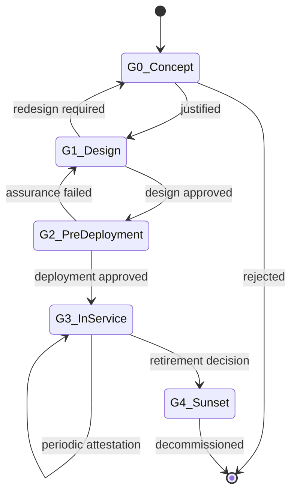
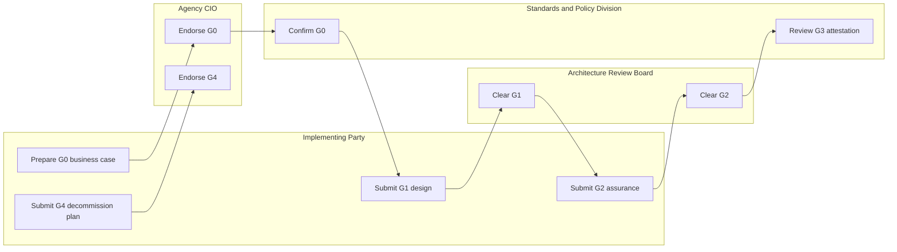
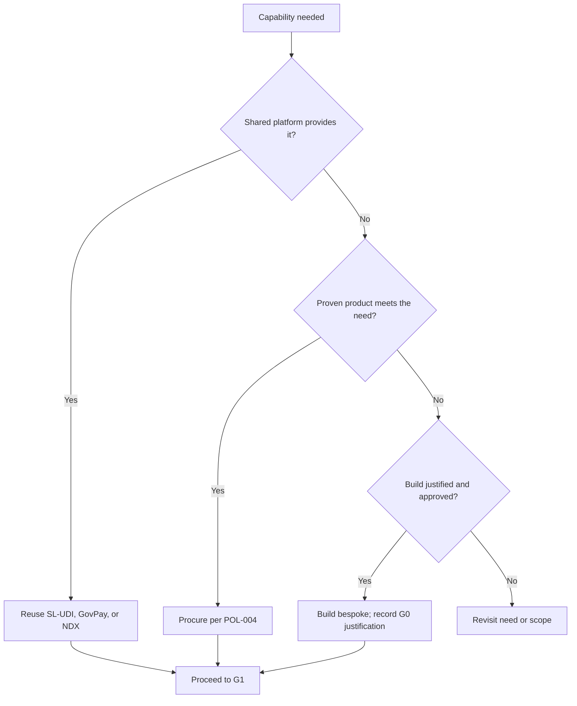

# POL-001: Software Governance Policy

**Document ID:** POL-001  
**Version:** 1.0  
**Status:** DRAFT (For Internal Review)  
**Classification:** OFFICIAL  
**Pillar:** Policy and Legal  
**Parent Document:** [GOV-001: GovTech Master Governance Policy](../Master_Governance_Policy.md)  
**Issued By:** GovTech Sri Lanka (Pvt) Ltd., Standards and Policy Division  
**Date:** June 2026  
**Aligned With:** Sri Lanka's Digital Economy Blueprint  

---

## Table of Contents

1. [Introduction](#1-introduction)
2. [Strategic Context: Sri Lanka's Digital Economy Blueprint](#2-strategic-context-sri-lankas-digital-economy-blueprint)
3. [Principles](#3-principles)
4. [Requirements](#4-requirements)
5. [Governance and Compliance](#5-governance-and-compliance)
6. [Roles and Responsibilities](#6-roles-and-responsibilities)
- [Appendix A: Glossary](#appendix-a-glossary)
- [Appendix B: Related Documents](#appendix-b-related-documents)

---

## 1. Introduction

### 1.1 Purpose

POL-001 governs the life of a government software initiative as an accountable undertaking, from business justification through design-stage and pre-deployment approval, into in-service ownership, and to funded retirement. It is the apex of the Policy and Legal pillar; the vendor, development, security, and data pillars operate within the lifecycle it defines.

This policy does not restate the enforcement model in GOV-001, the software development lifecycle mechanics owned by DEV-001, or the vendor sign-off mechanics owned by VAP-005. It defines the gates those documents operate within and refers to them at the point each applies.

### 1.2 Scope

This policy applies to every government software initiative, whether built in-house or procured, whether delivered by GovTech or a third-party vendor, across all ministries, departments, statutory bodies, and state-owned enterprises.

Commercial off-the-shelf office productivity software adopted without government-specific configuration is out of scope. Any other software that holds, processes, or exchanges government data, or that delivers a government service, is in scope.

### 1.3 Intended Audience

- Agency Chief Information Officers and Chief Technology Officers who commission software.
- System Owners accountable for systems in service.
- Solution architects, system integrators, and vendors who design and build government software.
- The GovTech Architecture Review Board and Standards and Policy Division, who clear the governance gates.

### 1.4 Definitions and Acronyms

This section defines only terms specific to POL-001. Shared terms (Impact Level, Enforcement Level, Extension Point, Deviation Register, SL-UDI, GovPay, NDX, SBOM) are defined in GOV-001 and are not redefined here.

| Term | Definition |
|---|---|
| Software Initiative | Any undertaking to acquire, build, or substantially change a government software system, from the point a need is identified to the point the resulting system is retired. |
| System Owner | The single named individual accountable for a system's compliance, security posture, and fitness throughout its life in service. |
| Gate | A defined decision point at which a software initiative shall obtain approval before it proceeds to the next phase. |
| Reuse, Buy, or Build | The mandatory assessment that decides whether a need is met by reusing a shared platform, procuring a product, or building bespoke software, in that order of preference. |
| Orphan Software | A government software system running in production without a current named System Owner. |

---

## 2. Strategic Context: Sri Lanka's Digital Economy Blueprint

Disciplined software governance serves the Blueprint's Trust and Governance enabler and its Policy, Legislation and Institutions enabler. A governed lifecycle is the precondition for every Digital Public Infrastructure service to be delivered accountably: it places a decision point and a named owner at each stage where public money and public trust are committed.

The reuse-first mandate in this policy directs investment toward the shared national building blocks (SL-UDI, GovPay, NDX), so each initiative compounds national platform value rather than rebuilding capability the government already operates. The depth of gate scrutiny scales with the System Impact Level defined in GOV-001 Section 6.2, so governance effort is proportionate to the consequence of failure.

---

## 3. Principles

The following principles bind every requirement in this policy.

1. Justify a software initiative against a defined need before any build begins.
2. Reuse a shared national platform first, procure a proven product second, build bespoke only when neither suffices.
3. Assign one named System Owner accountable for every system throughout its life.
4. Clear each governance gate before the next phase starts; approval is granted at the design stage, never retroactively.
5. Retire software through a planned, funded decommission; no system is left orphaned in production.
6. Scale the depth of gate scrutiny to the System Impact Level.

---

## 4. Requirements

Each requirement uses the obligation terms defined in GOV-001 and the writing rules. Every section that recommends a standard or process closes with the Extension Point block.

### 4.1 Software Governance Lifecycle and Gates

Every software initiative shall pass through five governance gates. Each gate shall be cleared before the next phase begins, consistent with the upfront-approval principle in GOV-001 Section 3.3; retroactive clearance shall not be granted. Gates G1 and G2 preserve the meaning GOV-001 already gives to "Gate 1" and "Gate 2"; gates G0, G3, and G4 extend that model across the full life of the system. The record of gate clearances is the system's primary compliance evidence trail.

| Gate | Name | Question answered | Approval authority | Evidence (illustrative) |
|---|---|---|---|---|
| **G0** | Concept and Justification | Should this software exist, and why not reuse or buy? | Agency CIO, endorsed by the Standards and Policy Division | Business case; reuse, buy, or build outcome; proposed System Impact Level |
| **G1** | Design and Architecture | Is the design compliant before build begins? | Architecture Review Board | Architecture description; standards conformance; any Extension Point requests |
| **G2** | Pre-Deployment Assurance | Is it safe and compliant to deploy? | Architecture Review Board; Chief Architect at Impact Level 3 to 4 | Security assurance per SEC-001; test evidence per DEV-003; SBOM |
| **G3** | In-Service | Is it owned, monitored, and accountable in production? | Named System Owner; reviewed by the Standards and Policy Division | Named owner; operational ownership record; periodic attestation |
| **G4** | Sunset and Decommission | Is retirement planned, funded, and data handled? | Agency CIO, endorsed by the Standards and Policy Division | Decommission plan; data disposal per DAT-004; successor mapping |

The lifecycle and its permitted transitions are shown below.

The authority that clears each gate is shown below. Roles are drawn from the GOV-001 role set; no new organisational title is created.

> **Extension Point: 4.1 Software Governance Lifecycle and Gates**
>
> **Default Recommendation.** A stage-gated software governance lifecycle aligned to a recognised gated delivery framework, for example the gate-review discipline in ISO/IEC/IEEE 12207:2017 (software life cycle processes).
>
> **Permitted Alternative Pathway.** A party may substitute the default with an alternative, subject to all of the following:
> - The alternative is itself grounded in a recognised international standard or documented industry best practice.
> - The party submits a written deviation request setting out: the rationale, the alternative standard (with version), and how the alternative meets the intent of the default requirement.
> - Prior written approval is granted by the GovTech Standards and Policy Division before implementation begins. Retroactive approval shall not be granted.
> - The approved deviation is recorded in the GovTech Deviation Register and the register reference is cited in the approved implementation plan.
>
> **Approval Authority.** GovTech Standards and Policy Division.
>
> **Evidence Required at Approval.** The gate plan mapping each gate to its entry criteria, evidence, and approval authority.
>
> **Review Frequency.** Annual.

### 4.2 Reuse, Buy, or Build Decision

Before commissioning any build at G0, the party shall complete a documented reuse, buy, or build assessment. The order of preference is binding: reuse a shared national platform where one provides the capability; where none does, evaluate a proven commercial or open-source product; build bespoke software only where the first two options are demonstrably insufficient.

Any architecture that bypasses or replicates a shared platform (SL-UDI, GovPay, NDX) shall obtain written approval from the GovTech Chief Architect before design begins, consistent with GOV-001 Section 5. The assessment outcome is mandatory G0 evidence.

> **Extension Point: 4.2 Reuse, Buy, or Build Decision**
>
> **Default Recommendation.** A documented reuse-first, then buy, then build evaluation method that prioritises the GovTech shared platforms.
>
> **Permitted Alternative Pathway.** A party may substitute the default with an alternative, subject to all of the following:
> - The alternative is itself grounded in a recognised international standard or documented industry best practice.
> - The party submits a written deviation request setting out: the rationale, the alternative standard (with version), and how the alternative meets the intent of the default requirement.
> - Prior written approval is granted by the GovTech Standards and Policy Division before implementation begins. Retroactive approval shall not be granted.
> - The approved deviation is recorded in the GovTech Deviation Register and the register reference is cited in the approved implementation plan.
>
> **Approval Authority.** GovTech Standards and Policy Division.
>
> **Evidence Required at Approval.** The completed reuse, buy, or build assessment, with the shared-platform bypass approval where applicable.
>
> **Review Frequency.** Per initiative at G0.

### 4.3 System Ownership and Accountability

Every government software system shall have a single named System Owner accountable for its compliance, security posture, and fitness throughout its life. The agency shall record each system and its current System Owner in a software asset register maintained for its portfolio.

No system shall run in production without a current named owner. An orphan system shall be either re-owned or routed to G4 sunset. On handover between a vendor and an agency, or between internal teams, ownership shall transfer in writing before the handover completes.

> **Extension Point: 4.3 System Ownership and Accountability**
>
> **Default Recommendation.** A software asset register and named-owner model aligned to a recognised IT asset and service management practice, for example ISO/IEC 19770-1 or ITIL 4 service ownership.
>
> **Permitted Alternative Pathway.** A party may substitute the default with an alternative, subject to all of the following:
> - The alternative is itself grounded in a recognised international standard or documented industry best practice.
> - The party submits a written deviation request setting out: the rationale, the alternative standard (with version), and how the alternative meets the intent of the default requirement.
> - Prior written approval is granted by the GovTech Standards and Policy Division before implementation begins. Retroactive approval shall not be granted.
> - The approved deviation is recorded in the GovTech Deviation Register and the register reference is cited in the approved implementation plan.
>
> **Approval Authority.** GovTech Standards and Policy Division.
>
> **Evidence Required at Approval.** The asset register entry naming the current System Owner.
>
> **Review Frequency.** Annual, and on any ownership transfer.

### 4.4 In-Service Governance and Sunset

A system in service at G3 shall undergo periodic governance attestation by its System Owner, at a cadence that tightens as the System Impact Level rises, confirming continued compliance and a current owner.

Sunset at G4 is a funded obligation. Each initiative shall plan for eventual decommission, and the agency shall budget for retirement when the system is commissioned. At decommission, data shall be retained or disposed of per DAT-004, and any successor system or migration path shall be recorded. A system shall not be silently abandoned.

> **Extension Point: 4.4 In-Service Governance and Sunset**
>
> **Default Recommendation.** A defined in-service attestation cadence and a funded decommission plan, with data disposal governed by DAT-004.
>
> **Permitted Alternative Pathway.** A party may substitute the default with an alternative, subject to all of the following:
> - The alternative is itself grounded in a recognised international standard or documented industry best practice.
> - The party submits a written deviation request setting out: the rationale, the alternative standard (with version), and how the alternative meets the intent of the default requirement.
> - Prior written approval is granted by the GovTech Standards and Policy Division before implementation begins. Retroactive approval shall not be granted.
> - The approved deviation is recorded in the GovTech Deviation Register and the register reference is cited in the approved implementation plan.
>
> **Approval Authority.** GovTech Standards and Policy Division.
>
> **Evidence Required at Approval.** The in-service attestation schedule and the decommission and data-disposal plan.
>
> **Review Frequency.** Annual.

---

## 5. Governance and Compliance

The Standards and Policy Division owns this policy. It confirms G0, reviews G3 attestation, and maintains the integrity of the gate evidence trail. The Architecture Review Board clears G1 and G2; the Chief Architect clears G2 for systems at Impact Level 3 to 4.

Gate clearance is the compliance evidence trail for each system, and maps directly to the enforcement model in GOV-001 Section 6 (System Impact Classification, Enforcement Levels, and non-compliance actions). A system that proceeds past a gate without clearance is non-compliant and is handled per GOV-001 Section 6.4. This policy references GOV-001 for repository-wide enforcement and does not duplicate it.

---

## 6. Roles and Responsibilities

| Role | Responsibility |
|---|---|
| GovTech Chief Architect | Clears G2 for systems at Impact Level 3 to 4; approves any shared-platform bypass before design begins. |
| Standards and Policy Division | Owns this policy; confirms G0; reviews G3 attestation; maintains the gate evidence trail. |
| Architecture Review Board | Clears G1 and G2; issues compliance findings at the design and pre-deployment gates. |
| Agency CIO | Commissions software; endorses G0 and G4; accountable for the portfolio's compliance. |
| System Owner | Single named accountability for a system's compliance, security posture, and fitness across its life, including in-service attestation and sunset. |
| Implementing Party (Vendor or Internal Team) | Prepares gate evidence; completes the reuse, buy, or build assessment; maintains the SBOM; implements to the approved design. |

---

## Appendix A: Glossary

This appendix defines terms specific to POL-001. Shared terms (Impact Level, Enforcement Level, Extension Point, Deviation Register, SL-UDI, GovPay, NDX, SBOM) are defined in GOV-001.

| Term | Definition |
|---|---|
| Software Initiative | Any undertaking to acquire, build, or substantially change a government software system, from the point a need is identified to the point the resulting system is retired. |
| System Owner | The single named individual accountable for a system's compliance, security posture, and fitness throughout its life in service. |
| Gate | A defined decision point at which a software initiative shall obtain approval before it proceeds to the next phase. |
| Reuse, Buy, or Build | The mandatory assessment that decides whether a need is met by reusing a shared platform, procuring a product, or building bespoke software, in that order of preference. |
| Orphan Software | A government software system running in production without a current named System Owner. |

---

## Appendix B: Related Documents

| Doc ID | Title | Relationship |
|---|---|---|
| GOV-001 | GovTech Master Governance Policy | Parent (apex); enforcement model and Impact Levels |
| POL-002 | Data Sovereignty and Personal Data Protection Act Compliance | Sibling; personal data obligations referenced at the gates |
| POL-003 | Open Standards and Vendor Neutrality Policy | Sibling; open-standards conformance assessed at G1 |
| POL-004 | Government Procurement Rules for Software | Sibling; procurement pathway for the buy decision |
| POL-005 | Intellectual Property and Licensing Policy | Sibling; licensing position for buy and build outcomes |
| VAP-001 | Vendor Registration and Eligibility Criteria | Dependency; vendor eligibility before gate submissions |
| VAP-005 | Approval and Sign-off Workflow | Dependency; vendor sign-off mechanics within the gates |
| DEV-001 | Software Development Lifecycle (SDLC) Policy | Dependency; engineering practice between G1 and G2 |
| DEV-003 | Testing and QA Requirements | Dependency; test evidence required at G2 |
| SEC-001 | Information Security Policy | Dependency; security assurance required at G2 |
| DAT-004 | Data Retention and Disposal Policy | Dependency; data disposal at G4 sunset |
| ARC-001 | Enterprise Architecture Reference Model | Sibling; approval-gate alignment |
| ARC-005 | NDX and GovPay Integration Standards | Dependency; shared-platform integration for the reuse mandate |
| DAT-003 | Data Interoperability and Exchange (NDX) | Dependency; shared-platform integration for the reuse mandate |
| SEC-005 | Identity and Access Management (SL-UDI Integration) | Dependency; shared-platform integration for the reuse mandate |

---

*This document is version-controlled in Git. Refer to the commit history for the complete change log.*  
*GovTech Sri Lanka (Pvt) Ltd., Standards and Policy Division, Colombo, Sri Lanka.*
