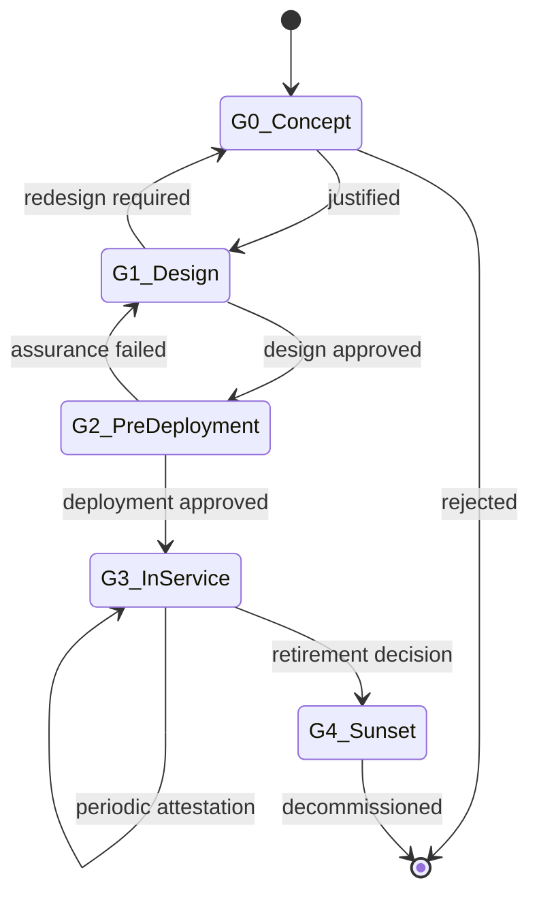
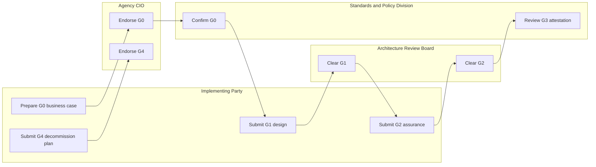
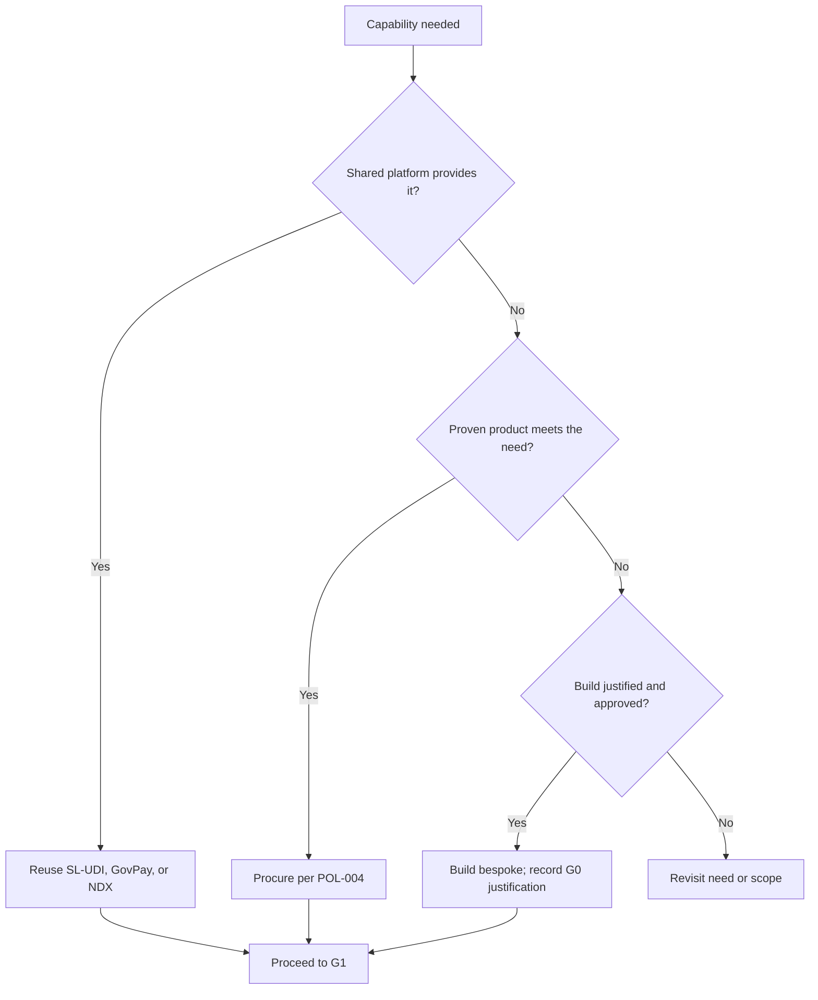

# POL-001 Software Governance Policy Implementation Plan

> **For agentic workers:** REQUIRED SUB-SKILL: Use superpowers:subagent-driven-development (recommended) or superpowers:executing-plans to implement this plan task-by-task. Steps use checkbox (`- [ ]`) syntax for tracking.

**Goal:** Author POL-001, the Software Governance Policy, as a single Markdown policy document that governs the life of a government software initiative through named gates (G0 to G4), the reuse/buy/build decision, named system ownership, and funded sunset, opening Pillar 1 (Policy and Legal).

**Architecture:** One master document under `docs/policy-legal/`, following the `docs/_template.md` layout and the canonical Extension Point block. It formalises a five-gate Software Governance Lifecycle (G0 Concept, G1 Design, G2 Pre-Deployment, G3 In-Service, G4 Sunset; G1/G2 preserve GOV-001's existing meaning), a reuse-before-buy-before-build mandate anchored on the shared platforms, single named System Ownership with no orphan software, and in-service plus funded sunset obligations. Deep specifics are delegated to the VAP, DEV, SEC, DAT, and POL-002..005 siblings. Three `mermaid` diagrams are embedded in the Markdown source. Two index files are updated to mark the document Draft.

**Tech Stack:** Markdown, Mermaid (GitHub-native rendering), Git. No build or test toolchain. Quality gates are the repo prose-lint greps, mermaid fence checks, and cross-reference checks.

**Source of truth:** Design spec at `toolbox/design/specs/2026-06-04-pol-001-software-governance-design.md`.

**Branch:** `pol-001-software-governance` (already created; the design spec is already committed on it). All authoring lands in ONE final commit (Task 12), then a PR.

**Binding writing rules (apply to every prose step):** no em dashes; no banned phrases ("it is worth noting", "it is important to note", "furthermore", "moreover", "in conclusion", "it should be noted", "this ensures that", "by doing so", "in order to", "with respect to"); no banned vocabulary ("robust", "leverage", "utilise", "facilitate", "streamline", "holistic", "cutting-edge", "best-in-class", "straightforward", "ensure that"); obligation terms `shall`/`shall not`/`should`/`may`/`must not`; active voice; no sentence over two clauses; do not start consecutive bullets with the same word; no invented platform/product names; brand as GovTech Sri Lanka, never ICTA; use "Sri Lanka's Digital Economy Blueprint".

**Mermaid rules (apply to every diagram step):** fenced ```mermaid blocks only; no em dashes inside node or edge labels (use commas, "to", or restructure); no banned vocabulary inside labels; keep node labels short; one diagram per fence. After each diagram, verify the fence opens and closes cleanly.

**Canonical Extension Point block** (used verbatim, fields filled, at the end of each Section 4.x requirement that recommends a standard or process; from `docs/_template.md` Section 4.0):

```
> **Extension Point: <Section Number and Title>**
>
> **Default Recommendation.** <standard/practice, with version>
>
> **Permitted Alternative Pathway.** A party may substitute the default with an alternative, subject to all of the following:
> - The alternative is itself grounded in a recognised international standard or documented industry best practice.
> - The party submits a written deviation request setting out: the rationale, the alternative standard (with version), and how the alternative meets the intent of the default requirement.
> - Prior written approval is granted by the GovTech Standards and Policy Division before implementation begins. Retroactive approval shall not be granted.
> - The approved deviation is recorded in the GovTech Deviation Register and the register reference is cited in the approved implementation plan.
>
> **Approval Authority.** GovTech Standards and Policy Division.
>
> **Evidence Required at Approval.** <artefacts>
>
> **Review Frequency.** <cadence>
```

**Standard prose-lint grep (referenced as `PROSE-LINT` below):**

```bash
grep -nE "—|it is worth noting|it is important to note|furthermore|moreover|in conclusion|it should be noted|this ensures that|by doing so|in order to|with respect to|robust|leverage|utilise|facilitate|streamline|holistic|cutting-edge|best-in-class|straightforward|ensure that" docs/policy-legal/POL-001_Software_Governance_Policy.md
```

Expected for every PROSE-LINT run: no matches.

---

### Task 1: Scaffold the document from the template

**Files:**
- Create: `docs/policy-legal/POL-001_Software_Governance_Policy.md`

- [ ] **Step 1: Create the file with front matter, TOC, and empty section headings.**

Front matter (match `docs/_template.md` and the GOV-001/ARC-001/DAT-001/SEC-001 patterns; each line ends with two trailing spaces; note the `../` prefix on the parent link because this file sits one level deep):

```
# POL-001: Software Governance Policy

**Document ID:** POL-001
**Version:** 1.0
**Status:** DRAFT (For Internal Review)
**Classification:** OFFICIAL
**Pillar:** Policy and Legal
**Parent Document:** [GOV-001: GovTech Master Governance Policy](../Master_Governance_Policy.md)
**Issued By:** GovTech Sri Lanka (Pvt) Ltd., Standards and Policy Division
**Date:** June 2026
**Aligned With:** Sri Lanka's Digital Economy Blueprint
```

Then `## Table of Contents` listing the six top-level sections plus Appendix A and B, then empty `##` headings. Section heading text: `1. Introduction`, `2. Strategic Context: Sri Lanka's Digital Economy Blueprint`, `3. Principles`, `4. Requirements`, `5. Governance and Compliance`, `6. Roles and Responsibilities`, `Appendix A: Glossary`, `Appendix B: Related Documents`.

- [ ] **Step 2: Verify front matter.** Run: `grep -nE "Document ID:|Version:|Status:|Pillar:|Parent Document:|Aligned With:" docs/policy-legal/POL-001_Software_Governance_Policy.md` Expected: six matching lines.

---

### Task 2: Section 1 Introduction

**Files:** Modify `docs/policy-legal/POL-001_Software_Governance_Policy.md`

- [ ] **Step 1: Write subsections 1.1 to 1.4.**
  - **1.1 Purpose:** POL-001 governs the life of a government software initiative as an accountable undertaking, from business justification through design-stage and pre-deployment approval, into in-service ownership, and to funded retirement. It is the apex of the Policy and Legal pillar; the vendor, development, security, and data pillars operate within the lifecycle it defines. It does not restate GOV-001's enforcement model, the SDLC mechanics owned by DEV-001, or the vendor sign-off mechanics owned by VAP-005.
  - **1.2 Scope:** applies to every government software initiative, whether built in-house or procured, whether delivered by GovTech or a vendor, across all ministries, departments, statutory bodies, and state-owned enterprises. Exclusions: commercial off-the-shelf office productivity software adopted without government-specific configuration, stated explicitly as out of scope.
  - **1.3 Intended Audience:** agency CIOs and CTOs who commission software; System Owners accountable for systems in service; solution architects and vendors who design and build; the GovTech Architecture Review Board and Standards and Policy Division who clear the gates.
  - **1.4 Definitions and Acronyms:** document-specific terms only, in a table: `Software Initiative`, `System Owner`, `Gate`, `Reuse, Buy, or Build`, `Orphan Software`. Reference shared terms (Impact Level, Enforcement Level, Extension Point, Deviation Register, SL-UDI, GovPay, NDX, SBOM) from GOV-001; do not redefine them.

- [ ] **Step 2: PROSE-LINT.** Expected: no matches.

---

### Task 3: Section 2 Strategic Context

- [ ] **Step 1: Write Section 2.** Two short paragraphs: (a) disciplined software governance serves the Blueprint's Trust and Governance enabler and its Policy, Legislation and Institutions enabler; a governed lifecycle is the precondition for every Digital Public Infrastructure service to be delivered accountably. (b) the reuse-first mandate directs investment to the shared building blocks (SL-UDI, GovPay, NDX), so each initiative compounds national platform value rather than rebuilding it; gate obligations scale with the System Impact Level defined in GOV-001 Section 6.2.
- [ ] **Step 2: PROSE-LINT.** Expected: no matches.

---

### Task 4: Section 3 Principles

- [ ] **Step 1: Write Section 3** as a short list of binding principles, one sentence each, distinct opening words:
  1. Justify a software initiative against a defined need before any build begins.
  2. Reuse a shared national platform first, procure a proven product second, build bespoke only when neither suffices.
  3. Assign one named System Owner accountable for every system throughout its life.
  4. Clear each governance gate before the next phase starts; approval is granted at the design stage, never retroactively.
  5. Retire software through a planned, funded decommission; no system is left orphaned in production.
  6. Scale the depth of gate scrutiny to the System Impact Level.
- [ ] **Step 2: PROSE-LINT; confirm no two consecutive principles open with the same word.** Expected: no matches.

---

### Task 5: Section 4.1 Software Governance Lifecycle and Gates

- [ ] **Step 1: Write the Section 4.1 narrative.** Every software initiative shall pass through five governance gates. Each gate is cleared before the next phase begins (GOV-001 Section 3.3); retroactive clearance shall not be granted. G1 and G2 preserve the meaning GOV-001 already gives "Gate 1" and "Gate 2"; G0, G3, and G4 extend that model. The gate evidence trail is the system's primary compliance record.

- [ ] **Step 2: Add the gate table.**

```
| Gate | Name | Question answered | Approval authority | Evidence (illustrative) |
|---|---|---|---|---|
| **G0** | Concept and Justification | Should this software exist, and why not reuse or buy? | Agency CIO, endorsed by the Standards and Policy Division | Business case; reuse, buy, or build outcome; proposed System Impact Level |
| **G1** | Design and Architecture | Is the design compliant before build begins? | Architecture Review Board | Architecture description; standards conformance; any Extension Point requests |
| **G2** | Pre-Deployment Assurance | Is it safe and compliant to deploy? | Architecture Review Board; Chief Architect at Impact Level 3 to 4 | Security assurance per SEC-001; test evidence per DEV-003; SBOM |
| **G3** | In-Service | Is it owned, monitored, and accountable in production? | Named System Owner; reviewed by the Standards and Policy Division | Named owner; operational ownership record; periodic attestation |
| **G4** | Sunset and Decommission | Is retirement planned, funded, and data handled? | Agency CIO, endorsed by the Standards and Policy Division | Decommission plan; data disposal per DAT-004; successor mapping |
```

- [ ] **Step 3: Add Diagram 1, the lifecycle state machine**, immediately after the gate table. No em dashes in labels.

````

````

- [ ] **Step 4: Add Diagram 3, the gate-authority swimlane**, after Diagram 1 (placed here so the gate model and its authorities sit together). Roles drawn from the GOV-001 role set; no invented titles; no em dashes in labels.

````

````

- [ ] **Step 5: Add the Extension Point block** for Section 4.1. Default Recommendation: a stage-gated software governance lifecycle aligned to a recognised gated delivery framework (for example the gate-review discipline in ISO/IEC/IEEE 12207 software life cycle processes). Evidence Required at Approval: the gate plan mapping each gate to its entry criteria, evidence, and approval authority. Review Frequency: annual.

- [ ] **Step 6: PROSE-LINT.** Expected: no matches.
- [ ] **Step 7: Verify mermaid fences balanced.** Run: `grep -c '^```mermaid' docs/policy-legal/POL-001_Software_Governance_Policy.md` Expected so far: 2.

---

### Task 6: Section 4.2 Reuse, Buy, or Build Decision

- [ ] **Step 1: Write the Section 4.2 narrative.** Before commissioning any build at G0, the party shall complete a documented reuse, buy, or build assessment. The order of preference is binding: reuse a shared national platform where one provides the capability; where none does, evaluate a proven commercial or open-source product; build bespoke software only where the first two are demonstrably insufficient. Any architecture that bypasses or replicates a shared platform (SL-UDI, GovPay, NDX) shall obtain written approval from the GovTech Chief Architect before design begins, per GOV-001 Section 5. The assessment outcome is mandatory G0 evidence.

- [ ] **Step 2: Add Diagram 2, the reuse/buy/build decision tree**, after the narrative. No em dashes in labels.

````

````

- [ ] **Step 3: Add the Extension Point block** for Section 4.2. Default Recommendation: a documented reuse-first, then buy, then build evaluation method, prioritising the GovTech shared platforms. Evidence Required at Approval: the completed reuse, buy, or build assessment with the platform-bypass approval where applicable. Review Frequency: per initiative at G0.

- [ ] **Step 4: PROSE-LINT.** Expected: no matches.
- [ ] **Step 5: Verify mermaid fences balanced.** Run: `grep -c '^```mermaid' docs/policy-legal/POL-001_Software_Governance_Policy.md` Expected so far: 3.

---

### Task 7: Section 4.3 System Ownership and Accountability

- [ ] **Step 1: Write Section 4.3.** Every government software system shall have a single named System Owner accountable for its compliance, security posture, and fitness throughout its life. The agency shall record each system and its current System Owner in a software asset register maintained for its portfolio. No system shall run in production without a current named owner; an orphan system shall be either re-owned or routed to G4 sunset. On handover between a vendor and an agency, or between teams, ownership shall transfer in writing before the handover completes.
- [ ] **Step 2: Add the Extension Point block** for Section 4.3. Default Recommendation: a software asset register and named-owner model aligned to a recognised IT asset and service management practice (for example ISO/IEC 19770-1 or ITIL service ownership). Evidence Required at Approval: the asset register entry naming the System Owner. Review Frequency: annual, and on any ownership transfer.
- [ ] **Step 3: PROSE-LINT.** Expected: no matches.

---

### Task 8: Section 4.4 In-Service Governance and Sunset

- [ ] **Step 1: Write Section 4.4.** A system in service (G3) shall undergo periodic governance attestation by its System Owner, at a cadence that tightens as the System Impact Level rises, confirming continued compliance and a current owner. Sunset (G4) is a funded obligation, not an afterthought: each initiative shall plan for eventual decommission, and the agency shall budget for retirement when the system is commissioned. At decommission, data shall be retained or disposed of per DAT-004, and any successor system or migration path shall be recorded. A system shall not be silently abandoned.
- [ ] **Step 2: Add the Extension Point block** for Section 4.4. Default Recommendation: a defined in-service attestation cadence and a funded decommission plan, with data disposal governed by DAT-004. Evidence Required at Approval: the attestation schedule and the decommission and data-disposal plan. Review Frequency: annual.
- [ ] **Step 3: PROSE-LINT.** Expected: no matches.

---

### Task 9: Section 5 Governance and Compliance

- [ ] **Step 1: Write Section 5.** The Standards and Policy Division owns this policy and confirms G0, G3, and gate-trail integrity; the Architecture Review Board clears G1 and G2, with the Chief Architect clearing G2 at Impact Level 3 to 4. Gate clearance is the compliance evidence trail for each system, and maps directly to the enforcement model in GOV-001 Section 6 (System Impact Classification, Enforcement Levels, and non-compliance actions). A system that proceeds past a gate without clearance is non-compliant and handled per GOV-001 Section 6.4. Reference GOV-001; do not duplicate it.
- [ ] **Step 2: PROSE-LINT.** Expected: no matches.

---

### Task 10: Section 6 Roles and Responsibilities

- [ ] **Step 1: Write Section 6** as a table. Keep role titles consistent with the GOV-001 role set; the System Owner is a named accountability, not a new organisational title.

```
| Role | Responsibility |
|---|---|
| GovTech Chief Architect | Clears G2 at Impact Level 3 to 4; approves any shared-platform bypass before design begins. |
| Standards and Policy Division | Owns this policy; confirms G0; reviews G3 attestation; maintains the gate evidence trail. |
| Architecture Review Board | Clears G1 and G2; issues compliance findings at the design and pre-deployment gates. |
| Agency CIO | Commissions software; endorses G0 and G4; accountable for the portfolio's compliance. |
| System Owner | Single named accountability for a system's compliance, security posture, and fitness across its life, including in-service attestation and sunset. |
| Implementing Party (Vendor or Internal Team) | Prepares gate evidence; completes the reuse, buy, or build assessment; maintains the SBOM; implements to the approved design. |
```

- [ ] **Step 2: PROSE-LINT.** Expected: no matches.

---

### Task 11: Appendices A and B

- [ ] **Step 1: Write Appendix A Glossary** for document-specific terms only (Software Initiative, System Owner, Gate, Reuse/Buy/Build, Orphan Software); reference shared terms from GOV-001.
- [ ] **Step 2: Write Appendix B Related Documents** table: GOV-001 (parent; enforcement and Impact Levels); POL-002, POL-003, POL-004, POL-005 (Pillar 1 siblings; PDPA, open standards, procurement, IP and licensing); VAP-001, VAP-005 (vendor eligibility and sign-off within the gates); DEV-001 (SDLC between gates), DEV-003 (test evidence at G2); SEC-001 (security assurance at G2); DAT-004 (data disposal at G4); ARC-001 (approval-gate alignment), ARC-005 and DAT-003 and SEC-005 (shared-platform integration referenced by the reuse mandate). Mark each Planned or Active/Draft per the README.
- [ ] **Step 3: Verify referenced Doc IDs exist.** Run: `for id in GOV-001 POL-002 POL-003 POL-004 POL-005 VAP-001 VAP-005 DEV-001 DEV-003 SEC-001 DAT-004 ARC-001 ARC-005 DAT-003 SEC-005; do grep -q "$id" docs/README.md && echo "$id ok" || echo "$id MISSING"; done` Expected: all `ok`.

---

### Task 12: Index updates, final verification, single commit and PR

**Files:**
- Modify: `docs/README.md`
- Modify: `docs/Master_Governance_Policy.md`

- [ ] **Step 1: Mark POL-001 as Draft in the indexes.** In `docs/Master_Governance_Policy.md` Section 4 Pillar 1, change the POL-001 row status from `Planned` to `Draft`. In `docs/README.md`, move POL-001 from the Planned table into the Active table (mirroring how ARC-001, DAT-001, and SEC-001 are listed), and remove its Planned-table row.

- [ ] **Step 2: Full PROSE-LINT across the new document and the indexes.** Run: `grep -nE "—|it is worth noting|it is important to note|furthermore|moreover|in conclusion|it should be noted|this ensures that|by doing so|in order to|with respect to|robust|leverage|utilise|facilitate|streamline|holistic|cutting-edge|best-in-class|straightforward|ensure that" docs/policy-legal/POL-001_Software_Governance_Policy.md docs/README.md docs/Master_Governance_Policy.md` Expected: no matches.

- [ ] **Step 3: No-invented-names and no-ICTA check.** Run: `grep -nE "GovPortal|GovApp|GovCloud|GovNotify|GovSign|eServices|ICTA" docs/policy-legal/POL-001_Software_Governance_Policy.md` Expected: no matches.

- [ ] **Step 4: Template conformance (Extension Points).** Run: `grep -cE "Extension Point:" docs/policy-legal/POL-001_Software_Governance_Policy.md` Expected: 4 (one per Section 4.1 to 4.4).

- [ ] **Step 5: Mermaid conformance.** Run: `grep -c '^```mermaid' docs/policy-legal/POL-001_Software_Governance_Policy.md` Expected: 3. Then confirm fences close: run `grep -c '^```$' docs/policy-legal/POL-001_Software_Governance_Policy.md` Expected: at least 3 closing fences for the diagrams (plus any code-block fences). Visually confirm each ```mermaid has a matching close.

- [ ] **Step 6: Single commit.**

```bash
git add docs/policy-legal/POL-001_Software_Governance_Policy.md docs/README.md docs/Master_Governance_Policy.md
git commit -m "Add POL-001 Software Governance Policy (draft)"
```

Commit body: summarise the five-gate lifecycle (G0 to G4), the reuse/buy/build mandate anchored on the shared platforms, named System Ownership with no orphan software, funded sunset, the three embedded mermaid diagrams, and the deferrals to the VAP, DEV, SEC, DAT, and POL siblings. Mark POL-001 Draft in the README and GOV-001 Section 4 indexes. No AI-attribution footer.

- [ ] **Step 7: Push and open a PR.**

```bash
git push -u origin pol-001-software-governance
gh pr create --base main --title "Add POL-001 Software Governance Policy (draft)" --body "<summary + verification notes; no AI-attribution footer>"
```

---

## Self-Review (completed during planning)

- **Spec coverage:** gate lifecycle G0 to G4 (Task 5), reuse/buy/build mandate (Task 6), system ownership and no orphan software (Task 7), in-service and funded sunset (Task 8), governance mapping to GOV-001 enforcement (Task 9), roles including the System Owner (Task 10), boundaries/deferrals (Tasks 6, 8, 11), front matter and structure (Tasks 1 to 11), index updates (Task 12). The three mermaid diagrams (lifecycle, decision tree, swimlane) are Tasks 5 and 6. All spec sections map to a task.
- **Placeholder scan:** the gate table, role table, both mermaid diagrams, and the Extension Point block are included verbatim; narrative sections specify exact required content. No "TBD"/"TODO".
- **Consistency:** gate names (G0 Concept, G1 Design, G2 Pre-Deployment, G3 In-Service, G4 Sunset) and their approval authorities are identical across the Task 5 table, the Task 10 role table, the Task 9 governance text, and both diagrams. The reuse/buy/build order (reuse, then buy, then build) is identical in the principle (Task 4), the narrative (Task 6), and Diagram 2. Deferrals (POL-004 procurement, DAT-004 disposal, SEC-001 assurance, DEV-003 test evidence, DEV-001 SDLC, VAP-005 sign-off) match the spec. Extension Point count expected = 4 matches the four Section 4.x requirements. Expected mermaid fence count = 3.
